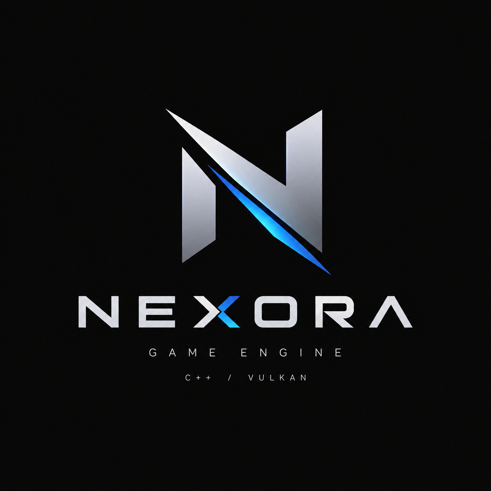

<p align="center">
  
</p>

# Nexora Engine

Игровой движок на C++23.

## Требования

- Windows 10/11
- Visual Studio 2026 с компонентом «Разработка классических приложений на C++»
- CMake 3.31+
- Python 3
- Conan 2 (`pip install conan`)
- Vulkan SDK (LunarG), переменная окружения `VULKAN_SDK`
- clang-format — только для форматирования кода

## Сборка

Все скрипты лежат в папке `Automation`. Конфигурация передаётся аргументом: `Debug` (по умолчанию) или `Release`.

| Скрипт | Что делает |
|---|---|
| `Automation\clean_rebuild_test.bat` | удаляет `Build`, пересобирает проект и запускает тесты |
| `Automation\rebuild_test.bat` | пересобирает проект и запускает тесты |
| `Automation\rebuild.bat` | пересобирает проект |
| `Automation\format_code.bat` | форматирует код по `Engine\.clang-format` |

Пример:

```bat
Automation\clean_rebuild_test.bat Release
```

Первая сборка дольше обычной: Conan скачивает и собирает зависимости (spdlog, GLFW, EnTT, GoogleTest).

Результат сборки лежит в `Build\bin\<Debug|Release>\`:

- `NexoraEngine.exe` — движок
- `NexoraEngineTestRunner.exe` — тесты

Решение для Visual Studio: `Build\Nexora.slnx`.

## VS Code

Нужны расширения C/C++ и CMake Tools (VS Code предложит их при открытии папки).

1. `Ctrl+Shift+P` → `Tasks: Run Task` → `Generate` — ставит зависимости Conan и генерирует проект. Нужно один раз и после изменения `conanfile.txt`.
2. CMake Tools подхватывает пресет `windows` из `CMakePresets.json`, IntelliSense берёт настройки из него.
3. `Ctrl+Shift+B` — сборка Debug, `F5` — запуск движка или тестов под отладчиком.
